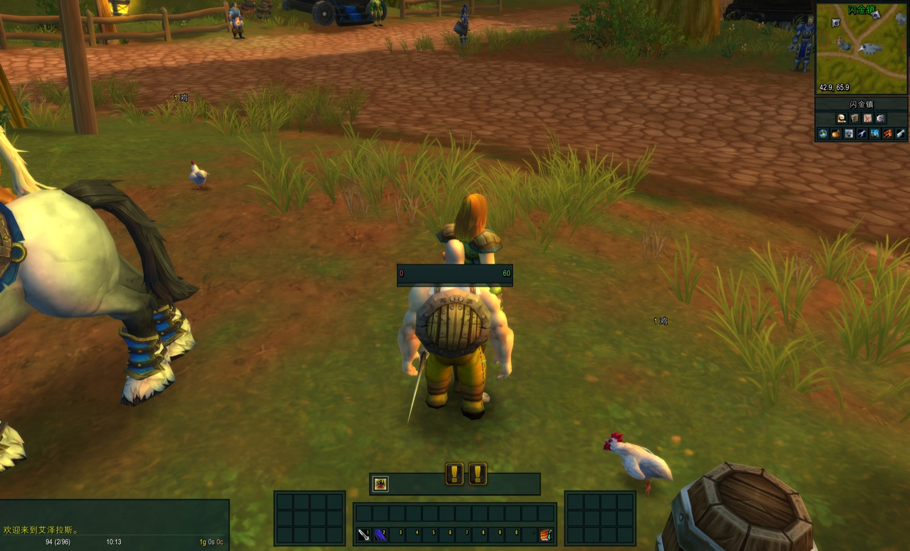

<p align="center">
  
</p>

<h1 align="center">Soloroth</h1>

<p align="center">
  一个在自己 Mac 上跑的魔兽世界 1.12.1 经典版：升级、探索、打怪。没有任务。<br>
  五人副本里机器人队友自动补满，一个人也能打完整个经典旧世。
</p>

<p align="center">
  
  
  <a href="LICENSE"></a>
</p>

> [!WARNING]
> Soloroth 不包含、不提供、也不链接魔兽世界客户端，你需要自己的 1.12.1（build 5875）客户端。
> 这是非官方的爱好者项目，与暴雪娱乐无关。代码只在 [这个仓库](https://github.com/vvenv/soloroth) 发布，别处提供的“整合包”或客户端下载都不是我们做的。

<p align="center">
  <a href="#快速开始">快速开始</a> ·
  <a href="#特色">特色</a> ·
  <a href="#日常使用">日常使用</a> ·
  <a href="#游戏里">游戏里</a> ·
  <a href="#常见问题">常见问题</a> ·
  <a href="GUIDE.md">完整说明</a> ·
  <a href="DEVELOP.md">开发者</a> ·
  <a href="https://github.com/vvenv/soloroth/issues">问题反馈</a>
</p>

<p align="center">
  
  
</p>
<p align="center">
  
  
</p>

---

## 特色

- **原版 1.12** + 简体中文，一个人也能打完旧世。
- **五人副本自动补 bot**；进度记在角色上，不会自己重置。
- **没有任务**；靠打怪、探索、副本升级；成就、挂机、传送 / 物品 / GM 工具都在。
- **pfUI 界面** + 小地图下命令条；宠物与坐骑学会法术后在「宠物」面板召唤。

目前只支持 **Apple Silicon 的 Mac**，从源码安装。细则见 [GUIDE.md](GUIDE.md)。

---

## 快速开始

### 需要准备

| 东西 | 说明 |
|---|---|
| Mac | Apple Silicon（M 系列）。目前在 macOS 26 上测试过 |
| 工具 | `xcode-select --install`；`brew install cmake mariadb openssl@3 pkg-config`；[rustup](https://rustup.rs) |
| 客户端 | 1.12.1 build 5875 的 `Data`（推荐 zhCN） |
| 地图数据 | vmangos 提取的 `maps` / `vmaps` / `mmaps` / `5875/dbc` |

默认数据放在仓库旁边的 `../wow-data/`（`client-zhCN/Data/` 与 `vmangos-deploy/storage/mangosd/extracted-data/`）。路径可变，见 [DEVELOP.md](DEVELOP.md)。

### 安装

```sh
git clone --recurse-submodules https://github.com/vvenv/soloroth.git
cd soloroth
./do.sh first          # 编译、配置、开服、建账号 → /Applications/Soloroth.app
```

双击 **Soloroth.app** → **开始游戏**。第一次会问账号密码，之后写进 `benilla-config/login.env` 自动登录。

启动器开着时服务器在后台跑；关掉窗口（或 ⌘Q）才离开 app。不想看启动器：··· →「编辑启动器设置」，设 `"skip": true`。

---

## 日常使用

| 做什么 | 命令 |
|---|---|
| 开始玩 | 双击 Soloroth.app，或 `./do.sh play` |
| 开 / 关服务器 | `./do.sh server` / `./do.sh stop` |
| 管理界面 | ··· →「打开管理界面」，或 `./do.sh admin`（`http://127.0.0.1:8765`） |
| 拉代码后更新 | `./do.sh build` → `./do.sh setup`；插件 `./do.sh addons` 后**完全重启**客户端 |
| 改服务端设置 | 改 `config/mangosd.overrides.conf` → `./do.sh config`，重启服务器 |
| 原版 / HD 模型 | 选项 → 图形 →「怪物模型」，或 `./do.sh visual` |

日志在 `server/logs/`。脚本与目录细节见 [DEVELOP.md](DEVELOP.md)。

---

## 游戏里

| 功能 | 怎么开 |
|---|---|
| 组队（2 / 3 / 5 / 解散） | 命令条 · **O** · `/zd` · `.bots fill` |
| 副本中心 | 命令条 · **L** · `/gd` |
| 传送 / 物品 / 宠物 / GM | **J** `/gt` · **I** `/gi` · **P** `/cw` · **G** `/gm` |
| 挂机 | **H** · `/dg` 打怪 · `/dy` 钓鱼 · `/cj` 采集 · `/gj` 全能 · `/bzd` 半自动 |
| 成就 | **Y** · `/ach` |
| 界面风格 / 怪物模型 | 选项 → 图形，或 `/style` · `/visual` |

进五人副本约 3 秒后自动补满队伍；活着离开会解散 bot。经验、掉落、挂机规则等见 [GUIDE.md](GUIDE.md)。

---

## 常见问题

<details>
<summary><b>启动器一直「正在启动服务器…」或「服务器启动失败」。</b></summary>

第一次开服要加载地图，会慢一些。底栏有日志最后一行；完整输出在 `server/logs/launcher.log` 和 `mangosd.out`。修好后点「重试」。
</details>

<details>
<summary><b>不想每次都看到启动器。</b></summary>

··· →「编辑启动器设置」，写上 `"skip": true`。
</details>

<details>
<summary><b>更多功能说明 / 脚本细节？</b></summary>

玩家侧细则：[GUIDE.md](GUIDE.md)。开发与上游：[DEVELOP.md](DEVELOP.md)。
</details>

---

## 致谢

- [Hordes of Azeroth](https://github.com/jonhaldors/hordes-of-azeroth)：最初起步处。
- [VMaNGOS](https://github.com/vmangos/core)、[benilla](https://github.com/samwhosung/benilla)、pfUI / Atlas 等：见 [THIRD-PARTY-NOTICES.md](THIRD-PARTY-NOTICES.md)。

## 关于

非官方爱好者项目，与 Blizzard Entertainment 无关。仓库不含游戏资源文件；需自备 1.12.1 客户端。代码 [GPL-3.0](LICENSE)。

发现问题请开 [issue](https://github.com/vvenv/soloroth/issues)，附上 `server/logs/` 里的日志。
