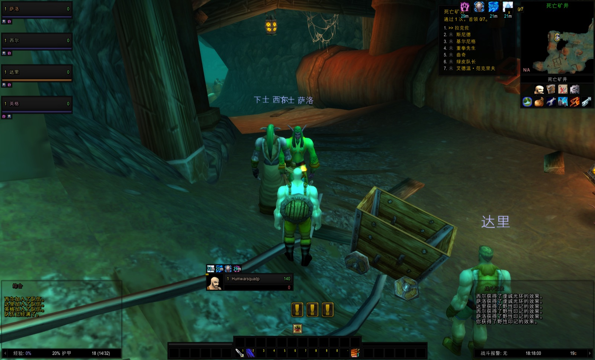
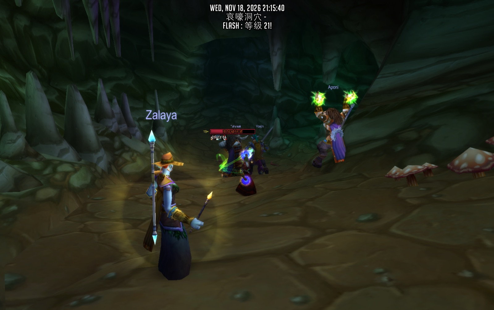
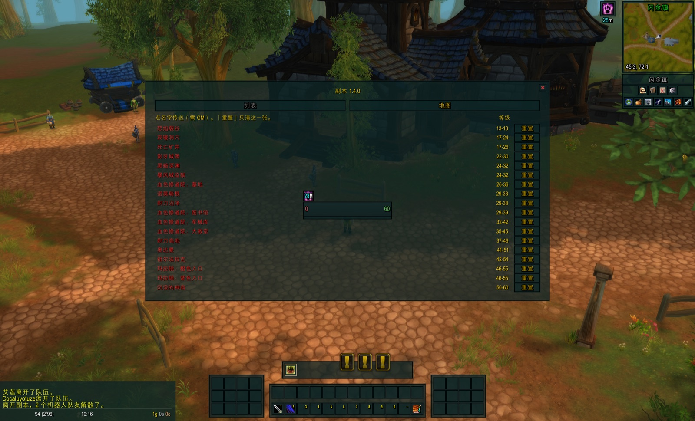

<p align="center">
  
</p>

<h1 align="center">Soloroth</h1>

<p align="center">
  一个在自己 Mac 上跑的魔兽世界 1.12.1 经典版：升级、探索、打怪。没有任务。<br>
  五人副本里机器人队友自动补满，一个人也能打完整个经典旧世。
</p>

<p align="center">
  
  
  <a href="LICENSE"></a>
</p>

> [!WARNING]
> Soloroth 不包含、不提供、也不链接魔兽世界客户端，你需要自己的 1.12.1（build 5875）客户端。
> 这是非官方的爱好者项目，与暴雪娱乐无关。代码只在 [这个仓库](https://github.com/vvenv/soloroth) 发布，别处提供的“整合包”或客户端下载都不是我们做的。

<p align="center">
  <a href="#快速开始">快速开始</a> ·
  <a href="#特色">特色</a> ·
  <a href="#日常使用">日常使用</a> ·
  <a href="#游戏里">游戏里</a> ·
  <a href="#常见问题">常见问题</a> ·
  <a href="DEVELOP.md">开发者</a> ·
  <a href="https://github.com/vvenv/soloroth/issues">问题反馈</a>
</p>

<p align="center">
  
  
</p>
<p align="center">
  
  
</p>

---

## 特色

- **原版内容**：服务端是原版 [vmangos](https://github.com/vmangos/core)，世界数据是 1.12 原样；原版只靠任务召唤的野外首领（桑德兰、阿利卡拉、密斯莱尔等）和轶事稀有「狮王修玛」改为世界刷新（约 5 分钟），方便单人碰到。
- **机器人组队**：进入五人副本 3 秒后，队伍自动补满 5 人。缺坦克就补坦克，缺治疗就补治疗，其余补不同职业的输出。叫来过的队友会一直跟着这个角色：存档保留，跟你一起升级，升级时换上更好的装备。掷骰全部放弃。活着离开副本时 bot 自动解散。副本进度留在角色上且永不自动重置；再从入口或 `/gd` 进同一份副本，回到上次离开时的坐标。掉线或闪退后再登录也回到原地、同一份副本。
- **中文**：用简体中文 1.12 客户端的数据，界面、NPC、物品都是中文。
- **单人化**：没有聊天频道，聊天框只当消息记录用（系统、拾取、经验、NPC 说话）。
- **公会「<角色名>之家」**：没有公会的角色登录时自己建一个、当会长，它的机器人队友都是会员，下线了也在名单上。用 `.partybot` 临时叫的 bot 只在场时算会员。已经在别的公会的角色不动。
- **界面**：统一的 pfUI 风格。小地图下是一条命令条（角色、法术书、天赋、地图、菜单，以及传送、物品、GM 工具、组队、挂机、副本）。副本中心、传送、物品、GM 工具、组队与挂机是内建功能，也可分别用 `/gd`、`/gt`、`/gi`、`/gm`、`/zd`、`/gj` 打开。ESC 菜单的「界面」可调布局。
- **自动挂机**：`/dg` 打怪、`/dy` 钓鱼、`/cj` 采集、`/gj` 全能；由服务器带着角色做。`/bzd` 半自动：自己走路，只在战斗时接管。
- **没有任务**：NPC 不给任务，也没有任务日志。靠击杀和拾取就能完成的内容仍在后台计数，完成时直接给原来的经验、金钱、声望和奖励；击杀经验 2 倍；职业任务技能改去训练师学；副本钥匙和进入资格去掉；奎尔塞拉、伦鲁迪利尔、祈福、天空之怒头盔等职业史诗挂在对应首领身上。
- **成就**：等级、探索、副本与团队副本，加上轶事（世界首领、稀有、任务召唤野外首领）和旅程（探索各章区域并打通副本）；没有任务类成就。默认按 `Y` 打开，达成时屏幕上方弹出提示。
- **低等级任务不白做**：等级高出任务太多、经验打折时，少拿的那部分经验按 60 级的规则折成金币。
- **经验 1 倍**，掉落和金钱也是 1 倍。想调可以在 GMBox 工具页或用 `.xprate`；少拿的任务经验折成金币。击杀经验再 ×2。
- **默认移速 2 倍**（跑步）。GMBox 工具页的 1x / 2x / 4x / 7x 会改这个倍率。
- **专业不限**：9 个主专业都能学；急救、烹饪、钓鱼照旧不占名额。
- **新角色自带 1 金和 4 只 8 格包**（棕色小皮包）。
- **原版或高清怪物模型**：游戏里一键切换，见下文「客户端外观」。

目前只支持 **Apple Silicon 的 Mac**，从源码安装。

---

## 快速开始

### 需要准备

| 东西 | 说明 |
|---|---|
| Mac | Apple Silicon（M 系列芯片）。目前在 macOS 26 上测试过 |
| 开发工具 | Xcode 命令行工具：`xcode-select --install` |
| Homebrew 包 | `brew install cmake mariadb openssl@3 pkg-config` |
| Rust | 用 [rustup](https://rustup.rs) 安装 |
| 1.12.1 客户端 | build 5875 的 `Data` 文件夹。推荐简体中文版（zhCN），英文版（enUS）也可以 |
| 服务端地图数据 | vmangos 提取工具从 1.12 客户端提取的 `maps`、`vmaps`、`mmaps` 和 `5875/dbc` |

默认把游戏数据放在仓库**旁边**的 `../wow-data` 里：

```
../wow-data/
├── client-zhCN/Data/        中文客户端的 MPQ
├── vmangos-deploy/storage/mangosd/extracted-data/
│   ├── maps/  vmaps/  mmaps/  5875/
```

数据放在别处、换英文客户端、或自己从客户端提取地图，见 [DEVELOP.md](DEVELOP.md)。

### 安装

1. 拉代码：

   ```sh
   git clone --recurse-submodules https://github.com/vvenv/soloroth.git
   cd soloroth
   ```

2. 运行 `./do.sh`，在菜单里选「第一次安装」（或直接 `./do.sh first`）。它会编译、配置、开服、建账号，最后生成 `/Applications/Soloroth.app`。第一次编译要一阵子。
3. 双击 **Soloroth.app**（或在启动台、Spotlight 里搜 Soloroth），在启动器里点 **开始游戏**。

### 启动器

双击 Soloroth.app 先打开启动器窗口（就是本页顶部那张图）。窗口一打开就在后台启动服务器，底栏显示进度：

- **开始游戏**：服务器就绪后进入游戏，自动登录（有账号文件时不显示账号密码框）。服务器还没好时点它，会等就绪后自动进入。启动失败时按钮变成「重试」，底栏显示日志最后一行。
- **退出游戏**（游戏里的退出 / 关掉客户端窗口）会回到这个启动器，可以再点「开始游戏」；服务器继续跑着。
- **底栏链接**：GitHub 和问题反馈。**···** 菜单里可以打开日志文件夹、插件文件夹、编辑启动器设置、关服务器。
- **关掉启动器窗口**（或 ⌘Q）才真正离开 app；服务器如果已经开了，会继续运行。

不想每次都看到启动器：点 ··· →「编辑启动器设置」，把 `"skip"` 改成 `true`。改背景图、标语等见 [DEVELOP.md](DEVELOP.md)。

### 自动登录

第一次启动会弹窗问一次账号密码，核对无误后保存到 `benilla-config/login.env`（不进 git）。之后启动器和 `./do.sh play` 会用它自动登录：

- 有账号文件时，默认黑屏自动进角色选择（不显示登录页）。
- 想跳过角色选择：在文件里加上 `WOW_CHAR=角色名`。
- 想恢复原版登录页：加上 `WOW_SHOW_LOGIN_UI=1`。
- 改了密码或想换账号，删掉 `login.env`，下次启动会重新问。
- 在弹窗里点取消且没有该文件时，游戏里会显示原生账号密码框以便手输。

---

## 日常使用

根目录 `./do.sh` 是交互菜单（也可 `./do.sh play` 等子命令）。Esc / ← 返回上一级。

| 做什么 | 命令 |
|---|---|
| 开始玩 | 双击 Soloroth.app，或 `./do.sh play` |
| 开 / 关服务器 | `./do.sh server` / `./do.sh stop`，或启动器的 ··· 菜单 |
| 拉代码后更新 | `./do.sh build`，再 `./do.sh setup`；插件用 `./do.sh addons` 后**完全重启**客户端 |
| 改了服务端设置 | 改 `config/mangosd.overrides.conf`，然后 `./do.sh config`，重启服务器 |
| 原版 / HD 模型 | 选项 → 图形 →「怪物模型」，或 `./do.sh visual`；重启生效 |

从 Soloroth.app 进游戏再退出，会回到启动器；服务器继续运行。服务器日志在 `server/logs/mangosd.out`，启动器日志在 `server/logs/launcher.log`。

### 客户端外观（原版 / HD 怪物模型）

默认是 **原版** 1.12 模型。想用更精细的怪物，下载社区补丁后在游戏里切换：

```sh
tools/macos/fetch-visual-patches.sh        # 下载 Reforged 生物包（约 2 GB，可中断续传）
tools/macos/fetch-visual-patches.sh --hd   # 再加环境 / 物品等整套
```

- **游戏里切换**：选项 → 图形 →「怪物模型」，或 `/visual` / `/waiguan`。选好后**完全退出再开**才会换模型。
- 方案：「原版」「高清怪物」「高清合集」（需 `--hd`）、「Improved Models」（需自己放 MPQ，见 `../wow-data/visual-patches/improved-models/` 的说明）。
- 文件不完整时，怪物会隐形或变成方块；下载器会按校验值核对。

---

## 游戏里

### 机器人队友

- 进五人副本 3 秒后自动补满队伍。登录时就在副本里也算进入。
- 活着离开副本，副本里补的 bot 会解散；死了跑尸的路上不会解散。走出去、炉石、`.go` 传送都算离开：杀过的怪和开过的门留在这个角色的这份副本里，**不会自动重置**，只有手动「重置副本」（副本中心 `/gd` 或角色右键菜单）才会清掉。再从入口或副本中心 `/gd` 进同一份副本，会回到上次离开时的坐标（不是入口）；重置后再进才从入口开始。掉线或客户端闪退会立刻存盘：再登录回到掉线时的位置和同一份副本。正在读条进副本时闪退，也按已绑定的那一份恢复。
- 副本里 bot 死了不跑尸。战斗结束后，会复活术的队友走过去读（牧师复活术、骑士救赎、萨满先祖之魂）。没人来读，大约 5 秒后原地起来，血量一半；有人正在过来，最多等 45 秒。你自己死了不会自动起来，等他们读条，或者自己跑尸。五人副本里整队团灭后，大约 8 秒（等怪复位）会把你和 bot 一起传到走过的最后一个安全点（不在敌对怪仇恨圈内的位置；进本时的入口作兜底），半血复活。
- 你变羊（或休眠、束缚、致盲等可被伤害打断的控场）之后，队友不会拿单体或范围技能去打它。坦克会尽量把其余怪拉到离羊远一点的位置，方便其他人放群体技能。
- 战斗里会更像老手：血蓝低了喝药水（优先治疗石 / 法力宝石），牧师给坦克上防护恐惧结界，萨满在有人被恐时改落战栗图腾，战士用狂暴之怒、亡灵用亡灵意志等解控，多怪时输出会先控一只再集火残血，牧师也会驱散怪身上的魔法增益。
- 团队副本不会自动补。野外或副本里想自己定人数，用小地图下面的组队按钮，或 `.bots fill 2`、`.bots fill 3`、`.bots fill 5`。人数比现在多就补上，比现在少就先送走输出，留下坦克和治疗。野外叫来的不会自动解散，右键那个按钮或 `.bots dismiss` 送走。
- 两人是你再加一名：你不是坦克就带坦克，你是坦克就带治疗。三人是坦克、治疗、输出。五人是满队。进五人副本时如果开着自动补，仍会补到五人，跟按钮上一次选的人数无关。
- bot 来自一份固定名单：每个阵营在 1.12 允许的**种族 × 职业 × 天赋**各一人（例如部落防战有兽人、亡灵、牛头人、巨魔）。名字是按种族气味取的中文短名（两三个字）。每次补位按缺的职责**随机**挑，并尽量选队伍里还没有的职业和种族。聊天框会报出谁来了，例如「铁颚（防护战士）、佐拉（神圣牧师）」。
- 某个名单位置第一次被叫到时，会给这个角色建一个存档队友，之后在「<角色名>之家」公会里；再点到同一位置还是这个人，等级跟上你（不会自己拿经验），升级时按新等级把更好的装备换上去。
- 名单上的名字谁先叫到归谁；别的角色叫同一个位置时会起一个新名字，之后也固定不变。删掉角色时，它的队友一起删掉。完整名单在服务端 `DungeonBotMgr.cpp` 的 `ROSTER`。

**组队**在小地图下命令条上，和挂机同一排。左键在命令条下面打开菜单（与命令条同宽）：两人、三人、五人、解散，以及「你的职责」（自动 / 坦克 / 治疗 / 输出，以及进副本是否自动补满）。右键直接解散。默认快捷键 **O**；也可用 `/zd`、`/zd 2`、`/zd 3`、`/zd 5`、`/zd x`。

没有指挥条或队员旁的复活 / 过来按钮：bot 默认冷静接战（等怪靠近再上），死后自己复活或队友读条，跟着你走即可。

旧世团本不是「再多几个人」：祖尔格拉布和安其拉废墟是 20 人，熔火之心、黑翼之巢、安其拉神殿、纳克萨玛斯是 40 人。服务端现在不往团队里补机器人，所以菜单里没有团本。以后要打团，得先让服务端能建团队再补人。

**副本中心**：点命令条上的副本按钮，或默认快捷键 **L**（也可用 `/gd` / `/fb`）。顶栏两页：**列表**、**地图**（宽度相同；人在副本里时默认开地图）：

- **列表**：五人副本按推荐等级排序，点名字进同一份未重置的副本时回到上次离开的坐标，否则进门内（需要 GM 账号）；3 秒后仍会自动补 bot。每一行的「重置」只清这一张（同一地图的多个入口一起清，人在里面时要先出来）。副本不会自己重置；右键命令条副本按钮仍可全部重置。
- **地图**：同一窗口内嵌副本布局图；点金色图例行叠出掉落（没有单独的掉落页签）。下拉可选五人、团本和世界首领。没有装备需求表和 PvP 掉落入口。
- **首领进度**：人在副本里时，屏幕右侧列出这一区的首领（带序号）。已击败的标成「已」，下一个还活着的用 `>>` 标出，标题下写通过了几次、首领几只里死了几只。小地图上用同样序号标出**当前视野内**的首领（金色＝下一个，灰色＝已击败；整张副本的布局仍看副本中心地图页）。五人和团队副本都显示。同一张地图的不同入口（血色、玛拉顿、厄运、斯坦索姆、黑石塔上下层）按你站的位置分开算。通过次数记的是这一区最终首领的击败次数：成就里已经击败过的至少算 1 次，之后每再击败一次加 1。重置副本会清掉当前这份进度，通过次数留下。右上角的叉暂时收起，换区域或再击败首领时重新出现。面板右缘对齐小地图，顶边贴在命令条下面，宽度与小地图相同。

组队仍在命令条上的组队按钮。`/gd reset`、`/gd map` 可直接跳到重置或地图。

| 命令 | 作用 |
|---|---|
| `.bots` | 查看职责和自动补位 |
| `.bots role tank\|healer\|dps\|auto` | 设定自己的职责 |
| `.bots auto on\|off` | 进副本是否自动补 bot |
| `.bots fill [2\|3\|5]` / `.bots dismiss` | 组成两人、三人或五人（不写人数就是五人）/ 解散 bot |

### 单人设置

每次登录都会生效：

- **聊天**：只有左下角「综合」和右下角「战斗记录」两个面板，一样大。综合只留系统、拾取、技能和 NPC 说话；战斗、金钱、经验和声望在右边。不会再单独开「拾取」窗。
- **没有荣誉面板**：角色窗和观察窗不显示荣誉页（单人没有 PvP 军衔）。
- **界面与命令条**：跳过首次向导；地图显示未探索区域；小地图放大并显示坐标。小地图下方是一条命令条（同宽）：上排角色、法术书、天赋、世界地图、主菜单（没有社交和帮助——单人用不上）；下排传送、物品、GM 工具、组队、挂机、副本（副本用钥匙图标，不跟地图撞脸）。副本进度面板贴在命令条下，同宽；图标按个数缩小后放进这条宽度里。底部左右聊天一样宽，信息条收在各自聊天框底部（左边经验、护甲、背包，右边战斗计时、时间、金钱）；自动卖灰色物品；升级和史诗装备自动截图等。快捷键 **N** 打开天赋。ESC → **界面** 可调布局与外观（也可用 `/pfui`）。
- **默认单键**：第一次登录时，若该键空闲（或仍绑在单人用不上的社交 / 任务日志 / 荣誉页上），会写好一次，之后你改过或清掉就不再覆盖——**J** 传送、**I** 物品、**G** GM 工具、**O** 组队、**H** 挂机菜单、**L** 副本中心、**Y** 成就。也可在「按键设置」里改。
- **背包容量**：默认背包是 32 格。其他背包和箭袋的格子是原来的两倍，最多 36 格（再大协议放不下，本来已经到 36 的包不变）。银行本身的格子不变。
- **背包整理**：打开背包后，右上角钥匙旁有整理按钮（银行窗口同样有），点一下叠堆并按类别排好。背包和银行上方有分类页签（全部 / 装备 / 消耗 / 配方 / 垃圾），点一下淡化其它类别。
- **击杀后自动拾取**（默认开）：掉落直接进背包。在「选项 → 控制」开关，或 `/autoloot on|off`。
- **拾取特效**（默认开）：物品飞进背包的动画。`/autoloot fx off` 关掉；`/autoloot test` 预览。
- **浮动战斗信息**：第一次登录时打开，以后可在「选项 → 战斗」里关掉。
- **角色名下不显示公会**：第一次登录时关掉（每个角色都有「之家」公会，名字下会很吵）；以后可在「选项 → 姓名板 → 玩家公会名称」打开。
- **中文界面**：界面文字（含内建功能窗）均为中文。

进世界、切地图和坐船时，只显示黑底和底部进度条，没有原版地图插画。

### 自动挂机（打怪、采集、钓鱼）

| 命令 | 作用 |
|---|---|
| `/bzd` | 半自动打怪：自己走路，自动战斗 |
| `/dg [码数]` | 只打怪（默认 40） |
| `/dy [码数]` | 只钓鱼（默认 25） |
| `/cj [码数]` | 只采集：采药、挖矿、剥皮（默认 40） |
| `/gj [码数]` | 全能（默认 40） |
| `/gj stop` | 停止 |

英文别名：`/grind`、`/fish`、`/gather`、`/assist`。命令条上有挂机按钮：左键在命令条下面打开菜单（与命令条同宽），右键停止；默认快捷键 **H** 也打开该菜单。「停止」可在按键设置里另绑。登录时也会自动建好对应宏，可拖到动作条。挂机时屏幕最上方有一条提示：模式、范围、时间，以及击杀、拾取、金币和熟练度变化，都写在同一行。停下来时聊天框打一行本趟汇总。`/gj` 不带参数也能看当前进度。码数是身边多远以内就动手，不是把人圈在原地；这一圈没有事就继续往前跑。钓鱼仍留在开始的那片水边。

- **半自动**（`/bzd`）：你自己赶路、转向。怪物打到你，或者你停下来并选中 30 码内看得到的怪，就自动追击、放技能。血量大约低于四成（旁边还有怪时大约五成）、法力大约低于三成（多只怪时大约四成）时，会喝治疗药水或法力药水；背包里有治疗石、法力宝石就先用，不跟药水抢同一个冷却。也会给自己加血。法力大约低于一成时：有魔杖就继续远程射击，否则上去近战。站着不动、没有选中目标时，血蓝低了会坐下吃喝休息；走路或选中目标会站起来。不游荡找下一只，不采集，不钓鱼。已经在打的怪被挡住时，会侧步到能看到的位置。走路不会把它关掉；死亡后保持开启，跑尸复活还能用。停止用面板「停止」或 `/gj stop`。
- **打怪**：身边这些码内有合适的怪就过去打、拾取；这一圈没有，就朝更远的下一处怪跑，再没有就顺着当前方向跑一大段，每隔几段换一个随机方向。洞里的弯道会顺着地走，不要求一条直线。目标被墙挡住、不在视野里时，会侧步或绕到能看到的位置再打。不进主城，不进敌对阵营的城镇，不往水里跑。血蓝低时坐下吃喝休息；野外不打精英、灰名、高 3 级以上的怪。五人副本里的精英和小群怪会清，队伍就是为此补的；团队副本不自动打。选怪和走路时会绕开其他怪的仇恨范围，不打会招来同伴的怪；只有满血满蓝时才接受多拉一只。三只以上扎堆的怪会一直跳过。组队时，队友或他们的宠物已经拉住的怪会先过去一起打，不再丢下这场战斗去找新的。战斗中的喝药、法力耗尽时的魔杖/近战，以及下面的控场、后撤，跟半自动一样。怪残血逃跑时，会用断筋、震荡射击、冰霜新星等减速、定身、昏迷技能把它留住；残血后撤也只往不会惊动别的怪的方向退。
- **控场**：旁边还有一只怪时，会优先控住血多的那只，再打另一只。法师变羊，德鲁伊休眠，牧师束缚亡灵，术士放逐或恐惧，猎人恐吓野兽，盗贼致盲。身上有自己的持续伤害（腐蚀术之类）就不再控，控住的那只宠物也不会去打。冰霜新星、爆炸、多重射击这类会波及到它的技能会先停手。法师会先新星再变羊，免得新星把羊打掉。
- **拉开距离**：远程职业被近身、而且对方已经被定身或控住、追不上来时，会往不会再拉到怪的方向退开。法师这个时候会转向背后闪现；猎人会后跳。对方还能追上时就站着打，不空跑。
- **钓鱼**：要先学会钓鱼、背包里有鱼竿；有鱼群就去鱼群边上钓。
- **采集**：有对应专业技能才做。有怪守着、走过去会招怪的点先跳过（全能模式下，守卫能打就会先清掉）。身边没有点时，朝更远的矿和草药跑，再没有就和打怪一样往前跑。
- **停止**：面板「停止」、`/gj stop`、按键绑定，或站着不动时按移动键（半自动除外，走路正是它要的）。死亡、背包满、下线时也会自动停。追怪追得离这一段路的起点太远也会停（自己换地方跑不算）。半自动只在你按下停止、下线或进入战场时停。
- **收获统计**：屏幕顶端那条提示实时显示击杀数、拾取物品数、赚到的钱，以及专业和辅助技能的熟练度。停止后聊天框给出一句总结，如「自动打怪结束（25:13）：击杀 23 只，获得 4银 12铜，经验 3450，拾取物品 31 件（绿色 2 件），采矿 +12（63→75）。」技能上限变了会写在后面，如「钓鱼 +2（73→75），上限 75→150」。挂机中输入 `/gj` 也能看到当前统计。`/reload` 不会清零。

### 成就

默认按 **Y** 打开（或 `/ach`）。获得成就时屏幕上方弹出提示。

- **综合 / 探索 / 地下城与团队副本**：覆盖 1.12 旧世界能做到的部分（没有任务分类）。
- **旅程**：旧世界四章——探索各章区域并打通沿途副本。
- **轶事**：霍格等稀有、世界首领、任务召唤野外首领（「现身受死」）。

### 传送

点命令条上的传送按钮，或默认快捷键 **J**（也可用 `/gt` / `/teleport`）。约 997 个传送点，中文、英文、拼音都能搜。

- 左键 `.tele`，Shift+左键按坐标 `.go xyz`，右键收藏。
- 底部可手输坐标、回到上次传送前的位置、查看当前坐标。
- `/gt 地名`：只有一个匹配就直接过去，多个就打开列表。
- 以前记在 GM 工具里的收藏和最近去过的地点，第一次打开时会搬过来。

### 物品

点命令条上的物品按钮，或默认快捷键 **I**（也可用 `/gi` / `/items`）。按名字或 id 搜，中英文都能搜。

- 左键按底部数量放进背包，Shift+左键只放 1 个，右键收藏。「我能用」按职业和等级筛。
- `/gi 名字 数量`：只有一个匹配就直接进包。
- 以前记在 GM 工具里的收藏、最近加过的物品和数量，第一次打开时会搬过来。

### GM 工具

点命令条上的工具按钮，或默认快捷键 **G**（也可用 `/gm`）。经验倍率、GM 模式、无敌、飞行、复活、修理、学技能、移速、加钱加等级等。

| 命令 | 作用 |
|---|---|
| `.xprate` | 查看当前经验倍率 |
| `.xprate off` / `.xprate on` | 停止 / 恢复全部经验 |
| `.xprate 0.5` | 只拿一半 |

经验减少时，任务少给的那部分经验折成金币。经验倍率按角色保存。

---

## 常见问题

<details>
<summary><b>启动器一直显示「正在启动服务器…」，或者「服务器启动失败」。</b></summary>

第一次开服要加载地图数据，会慢一些。失败时底栏会显示日志最后一行，完整输出在 `server/logs/launcher.log` 和 `server/logs/mangosd.out`（··· →「打开日志文件夹」）。修好后点「重试」。
</details>

<details>
<summary><b>不想每次都看到启动器。</b></summary>

··· →「编辑启动器设置」，写上 `"skip": true`。以后双击 app 直接开服进游戏。
</details>

<details>
<summary><b>更新代码 / 改配置 / 换外观数据要怎么做？</b></summary>

见上面「日常使用」表格。更细的脚本说明和目录结构见 [DEVELOP.md](DEVELOP.md)。
</details>

---

## 致谢

- [Hordes of Azeroth](https://github.com/jonhaldors/hordes-of-azeroth)：Soloroth 最初从这里起步。
- [VMaNGOS](https://github.com/vmangos/core)：服务端。
- [benilla](https://github.com/samwhosung/benilla)：客户端。
- pfUI、Atlas 等插件的作者们，见 [THIRD-PARTY-NOTICES.md](THIRD-PARTY-NOTICES.md)。

## 关于

非官方的爱好者项目，与 Blizzard Entertainment 无关。仓库和构建产物里不含任何游戏本身的文件：模型、贴图、声音、地图和游戏数据都来自你自己的 1.12.1 客户端。启动器的背景插画是为本项目生成的原创图，图标和 Logo 也是本项目画的。

World of Warcraft 和 Blizzard Entertainment 是 Blizzard Entertainment, Inc. 的商标或注册商标。

本仓库代码使用 [GNU General Public License v3.0](LICENSE)。客户端基于 [benilla](https://github.com/samwhosung/benilla)（MIT 或 Apache-2.0）。服务端基于 [VMaNGOS](https://github.com/vmangos/core)（GPL-2.0）。`Interface/AddOns` 里的第三方插件原样收录，不属于本仓库的 GPL，各自的作者和许可见 THIRD-PARTY-NOTICES.md。其他依赖见 [THIRD-PARTY-NOTICES.md](THIRD-PARTY-NOTICES.md)。

想改脚本、启动器、跟进上游，见 [DEVELOP.md](DEVELOP.md)。发现问题请开 [issue](https://github.com/vvenv/soloroth/issues)，附上 `server/logs/` 里的日志。
